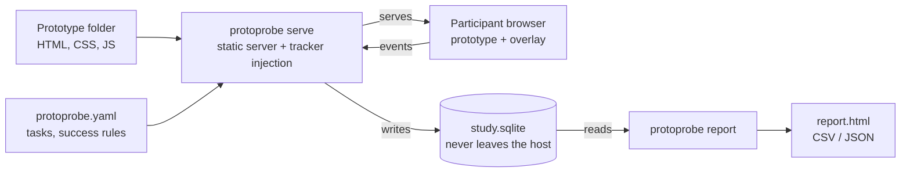

# ProtoProbe — Local Usability Testing Framework (PRD)

Oct 19, 2026 · Leo · Living version: the shared PRD doc. This file is a snapshot.

## TL;DR

ProtoProbe is an open source, local-first CLI that turns a folder of HTML prototypes into a usability test: define tasks in one YAML file, run sessions on your own machine, and get task metrics plus a shareable report. No SaaS, no account, no participant data leaving the laptop.

**Status:** MVP scope (P0 only, ~6 weeks, 1 dev) and MIT license approved on 19 Oct 2026. All pending items are decided — see Decisions.

## Problem & why now

HTML prototypes are now the cheapest thing to produce — AI tools generate a clickable flow in minutes. Testing them is the bottleneck.

- **Existing tools are built for Figma, not HTML.** Maze, Useberry and similar tools centre on design-tool imports; plain HTML/JS prototypes are second-class or unsupported.
- **They are SaaS.** Paid seats, participant data in a third-party cloud, and procurement/GDPR review before a single session. Many corporate environments simply block them.
- **The DIY fallback is a stopwatch and notes.** Moderated tests on a laptop produce no comparable numbers, so findings stay anecdotal and can't be compared across iterations.

**Impact:** teams skip testing or test late, and design decisions get made on opinion instead of task success and time-on-task data.

## Goals, non-goals, success metrics

**Goals**

1. Go from a folder of HTML files to a running test in under 5 minutes.
2. Capture standard usability metrics automatically, with zero changes to prototype code.
3. Keep 100% of session data on the host machine by default.
4. Produce a report a PM can drop into a review without post-processing.

**Non-goals (v1)**

- Participant recruiting, scheduling or incentives.
- Hosted/cloud mode or multi-user dashboards.
- Figma/Sketch import. HTML in, that's it.
- Video/webcam/audio recording (privacy and storage cost; revisit later).
- Statistical significance tooling for large unmoderated studies.

**Success metrics (6 months post-launch)**

| Metric | Target |
| --- | --- |
| Time from `npx` to first session | < 5 min |
| Prototypes needing code changes to be tracked | 0% |
| GitHub stars | 500 |
| External contributors with merged PRs | 10 |
| Sessions run in our own team per month | 20 |

Targets are assumptions to validate, not commitments.

## Users & core use cases

| User | Use case | What they need |
| --- | --- | --- |
| PM / designer (primary) | Moderated test, participant on the facilitator's laptop | Start a session in one command, task prompts on screen, report at the end |
| PM / designer | Remote test over LAN or tunnel | Shareable session link, data still lands on the host machine |
| Researcher | Compare two prototype variants (A/B) | Same task set, side-by-side metrics per variant |
| Engineer | Track custom events or define success in code | Small JS API, `protoprobe.success()` / `protoprobe.track()` |

**Core flow:** `protoprobe init` → write tasks in `protoprobe.yaml` → `protoprobe serve` → participant completes tasks → `protoprobe report`.

## Scope: MVP requirements

P0 = MVP, ships in v0.1. P1 = v0.2. P2 = later, only with demand.

| ID | Requirement | Priority |
| --- | --- | --- |
| R1 | CLI: `init`, `serve`, `report`, `export`. Install via `npx`, no global deps beyond Node | P0 |
| R2 | Serve any static HTML folder; auto-inject tracker script — no prototype changes | P0 |
| R3 | Task config in YAML: prompt, start URL, success condition (URL match, element visible, or JS event), time limit | P0 |
| R4 | Participant overlay: consent screen, task prompt, "Done" / "Give up" buttons, post-task question | P0 |
| R5 | Capture clicks, navigation, inputs (values masked), scroll, errors, timestamps | P0 |
| R6 | Local storage in a single SQLite file per study | P0 |
| R7 | Static HTML report: per-task and per-participant metrics, click paths, heatmap per page | P0 |
| R8 | CSV/JSON export of raw events and computed metrics | P0 |
| R9 | Session replay (DOM-based, not video) | P1 |
| R10 | Post-study SUS questionnaire, configurable | P1 |
| R11 | Variant comparison (A/B) in the report | P1 |
| R12 | Remote sessions: LAN link + optional tunnel, data still written locally | P1 |
| R13 | Facilitator view: live task status and notes timestamped to the session | P1 |
| R14 | Plugin API for custom metrics and report sections | P2 |
| R15 | Mobile/touch gestures and device frames | P2 |

**Acceptance for MVP:** a non-engineer runs a 3-task test with 5 participants and gets a report, without editing prototype code or reading source.

## Metrics captured

All metrics are computed from raw events, so new ones can be added later without rerunning sessions.

| Metric | Definition | Level |
| --- | --- | --- |
| Task success rate | % of attempts hitting the success condition before "Give up" or time limit | Task |
| Time on task | Task start → success/abandon, in seconds (median reported, not mean) | Task |
| Time to first click | Task start → first click; proxy for hesitation | Task |
| Misclicks | Clicks on non-interactive elements or off the expected path | Task |
| Path deviation | Pages/steps taken vs. the shortest defined path | Task |
| Backtracks | Browser back or return to a previously visited page | Task |
| Rage clicks | ≥3 clicks on the same element within 1 s | Task |
| Dead clicks | Clicks with no navigation, DOM change or handler | Task |
| JS errors | Uncaught errors during the task | Task |
| Single Ease Question (SEQ) | 1–7 rating after each task | Task |
| SUS score | 10-item System Usability Scale, 0–100 (P1) | Study |
| Click heatmap | Click density per page, normalised to viewport | Page |

**Assumption:** "expected path" is optional per task. Without it, misclicks and path deviation fall back to non-interactive clicks only.

## Architecture & tech choices

One CLI process does everything: serves the prototype, injects tracking, stores events, builds the report. No backend, no account.

The participant's browser is the only part that can sit on another device; events still stream back and are written only on the host.

| Area | Choice | Trade-off |
| --- | --- | --- |
| Runtime | Node.js + TypeScript, distributed via npm | Requires Node |
| Injection | Rewrite served HTML to add one script tag | Zero prototype changes; can clash with strict CSP |
| Tracker | Vanilla JS, no dependencies | More code to own vs. pulling an analytics lib |
| Transport | HTTP batch (`sendBeacon`) in v0.1; WebSocket when the facilitator view lands (P1) | Simplest path now; live view needs the upgrade |
| Storage | SQLite via built-in `node:sqlite`, one file per study | No native module to install; requires Node 22.13+ |
| Report | Single static HTML file with data embedded | Shareable anywhere; large studies make heavy files |
| Replay (P1) | rrweb, MIT licensed | Mature and DOM-based; adds bundle size and storage |

## Privacy

- No telemetry from the tool itself. Ever. Opt-in only if added later.
- Participants identified by generated ID; names optional and stored separately.
- All text inputs masked by default; unmask per field in YAML.
- Consent screen required before any capture; declining ends the session with nothing stored.
- `protoprobe purge` deletes a study's data in one command.

## Risks & trade-offs

| Risk | Impact | Mitigation |
| --- | --- | --- |
| Script injection breaks some prototypes (CSP, SPAs, iframes) | Tracking silently fails | Test against common setups (vanilla, React/Vite builds, AI-generated single files); health check in `serve` |
| SPA route changes not detected as navigation | Wrong time/path metrics | Hook History API + hash changes; manual `protoprobe.track()` fallback |
| Remote mode over tunnel exposes the machine | Security incident | Off by default, random token per session, read-only static serving |
| Local-only = no team dashboard | Harder to share results | Report is a single static HTML file; share it like any doc |
| Scope creep toward a Maze clone | Never ships | Non-goals above are hard; P2 needs a real user ask |
| Small sample sizes read as statistics | Bad decisions | Report shows n per metric and flags n < 5 |

## Decisions

| Topic | Decision | Trade-off accepted |
| --- | --- | --- |
| Distribution | npm only for v0.1 (`npx protoprobe`). Single binary moves to P2, triggered by 3+ install issues from non-dev users | Non-devs need Node installed; covered by a one-page install guide |
| Success conditions | YAML only in v0.1. Record mode (`protoprobe record`: click the happy path once, it writes the YAML) becomes P1 | Slower setup for non-devs in v0.1; keeps the 6-week scope |
| Session replay | rrweb, stays P1, off by default behind `--replay`, input masking on | Bigger bundle and storage only for those who opt in |
| Name | ProtoProbe. `protolab` is taken on npm; `protoprobe` is free (checked 19 Oct 2026) | — |
| Maintenance | Leo as sole maintainer, ~4 h/week after launch: weekly issue triage, monthly patch release, `good first issue` labels to grow contributors. No support SLA | Slow responses on issues; 4 h is an assumption to revisit |
| License | MIT | Allows closed forks; acceptable for adoption |
| Storage engine | Built-in `node:sqlite` instead of `better-sqlite3` | Drops native install friction; sets Node 22.13+ minimum |

## Milestones

1. **Weeks 1–2:** CLI skeleton, static server + injection, event capture to SQLite.
2. **Weeks 3–4:** YAML tasks, participant overlay, success detection, SEQ.
3. **Week 5:** Metrics engine + static HTML report + CSV export.
4. **Week 6:** Dogfood with 5 real sessions, docs, examples, v0.1 on npm + GitHub.
5. **After v0.1:** P1 items, ordered by feedback from the first users.

## Scaffold status (19 Oct 2026)

Already in the repo as a working skeleton: CLI (`init`, `serve`, `report`, `export`), HTML injection, tracker with consent + task overlay + SEQ, URL/visible/event success detection, time limits, SQLite storage, core metrics (success, time on task, first click, misclicks, rage clicks, errors, SEQ), basic HTML report, CSV/JSON export, unit tests, CI.

Still open for v0.1: heatmaps and click paths in the report, path deviation, backtracks, dead clicks, input-change capture with masking config, `purge`, `serve` health check.
